# Bingling user guide

[한국어](ko.md) · **English**

## Contents

1. [What is Bingling](#what-is-bingling)
2. [Install](#install)
3. [Basic use](#basic-use)
4. [Reading the ring](#reading-the-ring)
5. [The six picture tools](#the-six-picture-tools)
6. [Editor shortcuts](#editor-shortcuts)
7. [The result card](#the-result-card)
8. [Settings](#settings)
9. [FAQ](#faq)
10. [Credits](#credits)

## What is Bingling

Drag files in File Explorer, press <kbd>Ctrl</kbd>, and a ring opens around your cursor (the app calls it the donut toolbar).
Drop the files on a slot to convert them, or to crop, redact or draw on pictures, without leaving File Explorer.

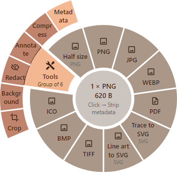

## Install

Bingling runs on Windows 10 and 11.

1. Download `Bingling-<version>-win-Setup.exe` from the [release page](https://github.com/likyu-room/bingling/releases/latest) and run it.
2. The installer is not code-signed yet, so Windows may show "Windows protected your PC".
   Click **More info**, then **Run anyway**.
3. Choose the **install mode**.
   - **Install for all users (recommended)**: the usual choice. It needs administrator rights, so Windows asks once.
   - **Install for me only**: installs for your account only, without administrator rights. Choose it when Windows asks
     for an administrator's name and password, as on many work PCs. The Windows 11 menu option is then left out, and
     Bingling appears under “Show more options”.
4. Choose the options. Setup shows them on the first install.

   | Option | At first | What it does |
   |---|---|---|
   | Show “Convert with Bingling” in the Explorer context menu | On | Right-click files to open Bingling. |
   | Also show it at the top of the Windows 11 menu | On | Windows 11, installed for all users only. The entry shows without clicking “Show more options”. |
   | Start Bingling when I sign in | On | Bingling waits in the tray when you turn on the PC. The ring only opens while Bingling runs. |
   | Add the "bingling" command to PATH | Off | Convert with the `bingling` command in a terminal. Turn it on only if you need it. |

5. Choose the **conversion engines**.
   Pictures, PDF, Word, Excel and PowerPoint, HWP, e-books, archives, fonts, CAD and 3D models convert without any of them.
   The engines below are large, so download only the ones you need. The page shows each download size.

   | Engine | You need it for |
   |---|---|
   | LibreOffice | Older documents such as DOC and PPT, Pages, Keynote, Numbers, WordPerfect, Publisher and Visio |
   | Pandoc | Markup formats such as Markdown, LaTeX and Org, and PPTX slides from Markdown |
   | Ghostscript | EPS, PostScript and older Illustrator files |
   | FFmpeg | Video and audio |
   | Calibre | MOBI and AZW3 for Kindle, and rare e-book formats |

   The engines you pick are downloaded when Bingling starts after Setup.
   You don't have to pick any now: you can install or remove engines at any time in **Settings → Engines**.

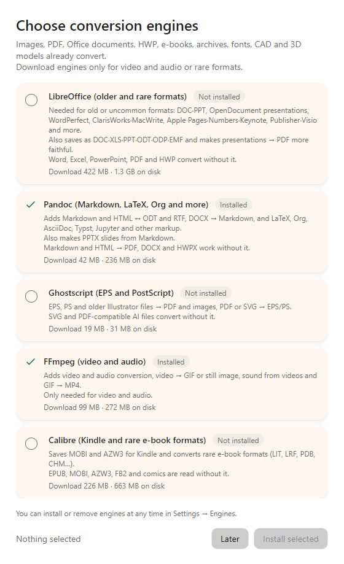

The “Choose conversion engines” window in Bingling. Setup offers the same engines.

After Setup, Bingling runs in the notification area of the taskbar (the tray).
Updates don't ask about engines again. Your settings and engines stay.

### Without installing (portable)

If you can't run Setup or would rather not install, use the portable ZIP. It needs no administrator rights.

1. Download `Bingling-<version>-win-Portable.zip` from the [releases page](https://github.com/likyu-room/bingling/releases/latest).
2. Unpack it into a folder you will keep (for example `Documents\Bingling`).
3. Run `Bingling.exe` in that folder. If “Windows protected your PC” appears, choose **More info**, then **Run anyway**.

- The ring, the picture tools, conversions, the result card and engine downloads work as in the installed copy.
- On its first start it registers “Start Bingling when I sign in” and the Explorer context menu for your account. On
  Windows 11 the menu entry is under “Show more options”.
- Settings are kept in the same place as the installed copy's (`%APPDATA%\Bingling`). It is not meant to be carried to
  other PCs on a USB stick.

**Updating**: when a new version is out, its card has a **Download** button that opens the releases page. Right-click
the tray icon, choose **Quit**, then unpack the new ZIP over the same folder. Your settings and engines stay.

**Removing it**: in **Settings → General**, turn off “Start Bingling when I sign in” and “Show ‘Convert with Bingling’ in
the Explorer context menu”, choose **Quit** in the tray, then delete the folder. To delete the downloaded engines as
well, delete the `%LocalAppData%\Bingling` folder too.

## Basic use

### Open the ring by dragging

1. Drag files in File Explorer or on the desktop. You can drag many at once.
2. While dragging, press <kbd>Ctrl</kbd>. The ring opens around your cursor. (Holding <kbd>Ctrl</kbd> before you start dragging works too.)
3. Release the mouse button over the slot you want.

After the drop the ring turns into a small progress ring, and a ✓ shows when it is done.
If it takes longer than 5 seconds, the [result card](#the-result-card) in the bottom-right corner takes over.

The result is saved **as a new file in the same folder as the original**. The original stays as it is.
If a file of that name already exists, a number is added (for example `photo (2).jpg`).

To cancel, drop the files in the middle of the ring. The middle says “Drop here to cancel”.

### Other ways to open it

| Way | How |
|---|---|
| Keyboard shortcut | Select files in File Explorer and press <kbd>Ctrl</kbd>+<kbd>Alt</kbd>+<kbd>Space</kbd> with the pointer over the File Explorer window. The ring opens there. |
| Right-click menu | Right-click files and choose **Convert with Bingling**. On Windows 11 it is under “Show more options” unless you added it to the main menu. |
| Bingling window | Drag files onto “Drop files here” on the **Home** page of the Bingling window. |
| Watch folders | Files that land in a folder you chose are converted on their own. Set one up in [Settings](#watch-folders). |

A ring opened these ways is used by **clicking** a slot. The middle says “Esc to close”, and <kbd>Esc</kbd> closes it.
You can also move between slots with the arrow keys or <kbd>Tab</kbd> and choose with <kbd>Enter</kbd>.

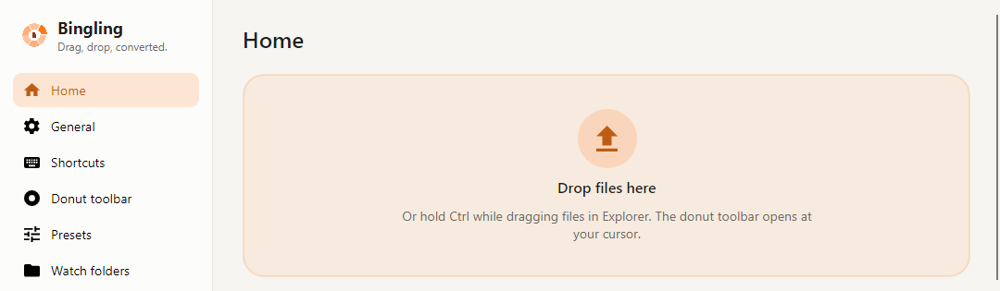

**Want Shift too?** **Settings → Shortcuts** has a “Shift + Left” gesture that is switched off. Switch it on, and dragging with <kbd>Shift</kbd> opens the ring as well.

**Closing the Bingling window:** when it asks “Keep Bingling running?”, choose **Keep in tray**.
**Quit** stops Bingling, and the ring no longer opens. Click the tray icon to open the window again.

## Reading the ring

Look at the [picture above](#what-is-bingling) while you read this.

- **The middle** shows the format and number of the files you brought, and their total size (for example “1 × PNG · 620 B”, or “3 files” for mixed formats).
  Over a slot, its second line says what will happen, such as “Drop → JPG” (“Click → JPG” on a ring you click).
  Over the middle, it says “Drop here to cancel”.
- **Slots**: each slot does one thing. The large text is its name, the small text the format of the result.
  A slot that keeps the format, such as “Half size”, shows the source format in small text.
- **A ring for each kind of file**: pictures, PDF, documents, video and so on each get their own ring. A mix of kinds gets the “Mixed files” ring.
  A ring holds up to 12 slots.
- **Group slots**: a slot with “Group of 6” in small text, like “Tools”, holds several slots.
  Rest on it or move outward and its slots fan out around it. While dragging, drop on one of those.
- **Dimmed slots** can't be used with these files. Point at one and the middle tells you why, for example:
  - “Needs FFmpeg (video and audio). Install it in Settings → Engines”: install that engine and the slot works.
  - “Only single still pictures can be edited”: the picture tools don't work on pictures with several frames, such as animated GIFs.
  - “No engine can do this conversion”
- **Editing a slot**: on a ring opened by the shortcut or a menu, right-click a slot to change its preset right away.

## The six picture tools

The **Tools** slot of the picture ring holds six tools. Rest on it and they fan out.

- **Crop, Add background, Redact and Annotate** open an editing window where the ring was.
- **Compress and Strip metadata** run right away, without a window.
- Crop, Add background, Redact and Annotate work on single still pictures. If an animated GIF or an icon (ICO) is among the files, their slots are dimmed.

### What every editing window has

- The top left shows the tool and the file name (for example “Crop · beach.png”).
- The buttons at the top right are **Undo**, **Redo** and **Fit to window**.
- The buttons at the bottom are **Reset**, **Cancel**, **Copy** and **Save**. As the note beside them says, the original stays untouched: the result is saved next to it as a new file.
- **Copy** (<kbd>Ctrl</kbd>+<kbd>C</kbd>) copies the edited picture without making a file, ready to paste into a chat or a document.
  The window then closes. To keep it open, to edit more or save a file too, change it in **Settings → General → Image tools**.
  With several pictures, Copy takes the one you are looking at, and the window stays open so you can copy the next.

**Several files at once**

With several pictures, the top shows which one you see, such as “1 of 2”.
Step through them with the ‹ › buttons or the <kbd>←</kbd> <kbd>→</kbd> keys.

- Crop, Add background and Redact: your settings go on **every picture the same way**. The bottom says “Applies to all 2 files”.
- Annotate: you draw on **each picture separately**, and only the pictures you drew on are saved.

**File names**

A word is added to the name. For `photo.jpg`:

| Tool | Saved as |
|---|---|
| Crop | `photo Cropped.jpg` |
| Add background | `photo with background.png` (always PNG) |
| Redact | `photo Redacted.jpg` |
| Annotate | `photo Annotated.jpg` |
| Compress | `photo Compressed.jpg` |
| Strip metadata | `photo Clean.jpg` |

Except for Add background, the result keeps the format of the original.

### Crop

Keeps only the part of the picture you want.

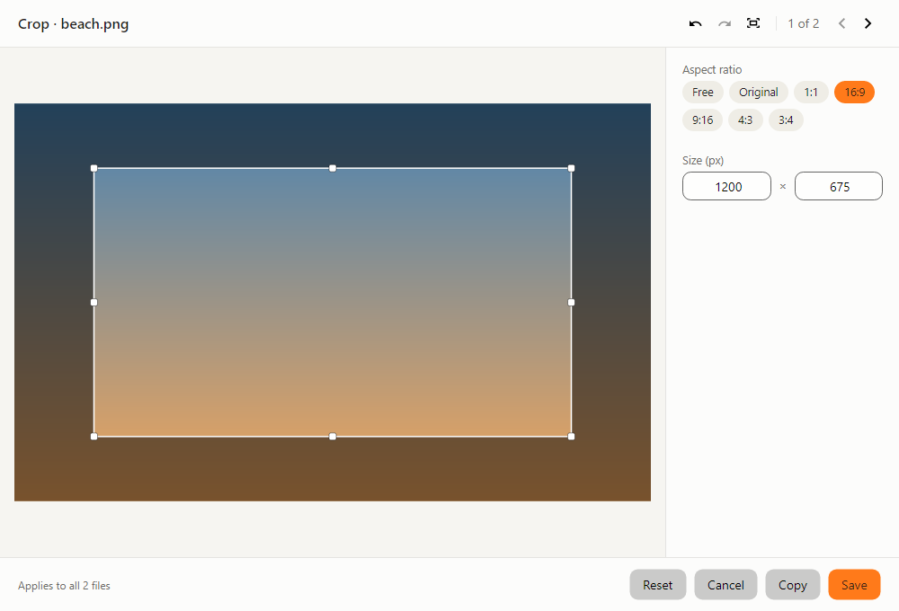

1. Drag pictures and drop them on **Tools → Crop**.
2. Pick a shape under **Aspect ratio**: Free, Original, 1:1, 16:9, 9:16, 4:3 or 3:4. The number keys <kbd>1</kbd> to <kbd>7</kbd> pick them too.
3. Drag the box to move it, and drag its corners or edges to resize it. Dragging outside the box draws a new one.
   You can also type numbers under **Size (px)**.
4. Click **Save** or press <kbd>Enter</kbd>. A double click inside the box saves too.

- With “Free”, hold <kbd>Shift</kbd> while dragging to keep the box's shape.
- The ratio you picked is remembered for next time.

### Add background

Puts the picture on a backdrop with padding, like a card, with rounded corners and a shadow if you like.

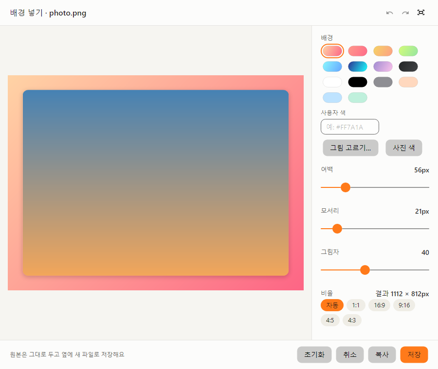

Shown with the Korean interface. The English window has the same layout.

1. Drop pictures on **Tools → Add background**.
2. Under **Background**, pick one of 8 gradients or 6 solid colours.
   - **Custom color**: type a colour code such as `#FF7A1A` and it applies right away.
   - **Choose image…**: use a picture of your own as the backdrop.
   - **Photo color**: fills the background with the photo's average colour, softened with white.
3. Move the **Padding**, **Corners** and **Shadow** sliders. Each shows its value above it on the right.
4. Pick the shape of the result under **Aspect ratio**: Auto, 1:1, 16:9, 9:16, 4:5 or 4:3. The size of the result shows as “Result: 1112 × 812px”.
5. Click **Save**.

The result is always a PNG. The backdrop you chose is remembered for next time.

### Redact

Hides what you don't want to show, such as a name or a phone number, with a black box or a mosaic.

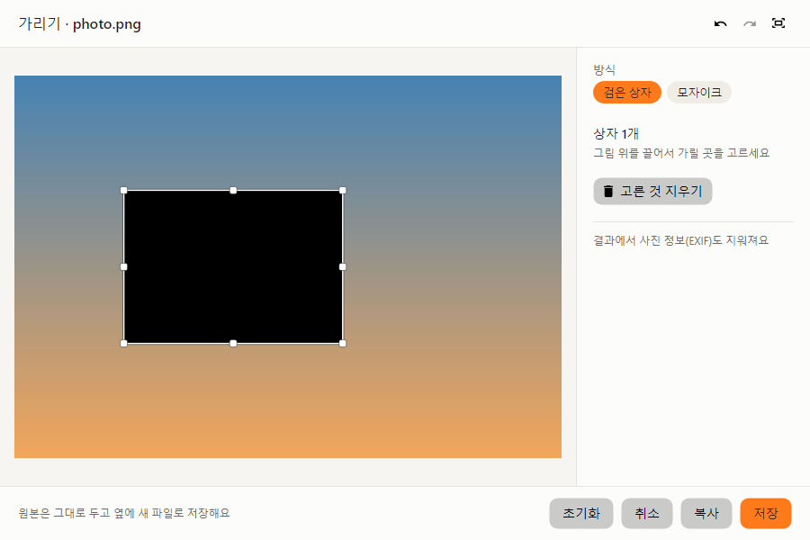

Shown with the Korean interface. The English window has the same layout.

1. Drop pictures on **Tools → Redact**.
2. Under **Style**, pick **Black box** (<kbd>B</kbd>) or **Mosaic** (<kbd>M</kbd>).
3. Drag on the picture to draw a box over what to hide. Draw as many as you need.
   - Click a box to select it, drag it to move it, and drag a corner to resize it.
   - Remove the selected box with **Delete selected** or <kbd>Delete</kbd>.
4. Click **Save**. Save stays off until there is at least one box.

> **The photo info goes too.** Redact always removes the photo info (EXIF), such as where and with what camera the
> photo was taken, because that info can still hold what you hid.

With several pictures, the same boxes go in the same place on each. Check each picture with ‹ ›.

### Annotate

Marks up a picture with arrows, text, numbers and more.

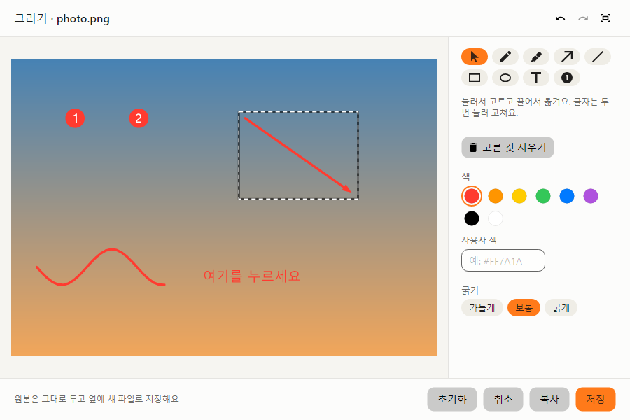

Shown with the Korean interface. The English window has the same layout.

1. Drop pictures on **Tools → Annotate**.
2. Pick a tool at the top right.

   | Tool | Key | How |
   |---|---|---|
   | Select | <kbd>V</kbd> | Click to pick, drag to move. Double-click a text to edit it. |
   | Pen | <kbd>P</kbd> | Drag to draw. |
   | Highlighter | <kbd>H</kbd> | Drag to draw a wide, see-through line. |
   | Arrow | <kbd>A</kbd> | Drag to draw. Hold <kbd>Shift</kbd> for straight angles. |
   | Line | <kbd>L</kbd> | Drag to draw. Hold <kbd>Shift</kbd> for straight angles. |
   | Rectangle | <kbd>R</kbd> | Drag to draw. Hold <kbd>Shift</kbd> for a square. |
   | Ellipse | <kbd>E</kbd> | Drag to draw. Hold <kbd>Shift</kbd> for a circle. |
   | Text | <kbd>T</kbd> | Click where you want it. <kbd>Enter</kbd> finishes, <kbd>Shift</kbd>+<kbd>Enter</kbd> starts a new line. |
   | Number | <kbd>N</kbd> | Each click adds the next number: 1, 2, 3… |

3. Pick a **Color** (8 colours, or a code under **Custom color**) and a **Thickness** (Thin, Normal, Thick).
   <kbd>[</kbd> and <kbd>]</kbd> change the thickness too, which also sets the size of text and numbers.
4. Click **Save**. Save stays off until you have drawn something.

- Select a drawing with the Select tool, then click a colour or a thickness: that drawing changes at once. <kbd>Delete</kbd> removes it.
- **Each picture has its own drawings.** Another picture shows only what you drew on it, and undo works per picture too.
  Only the pictures you drew on are saved, and the bottom says so, such as “Only the 2 marked files will be saved”.
- If you close the window with drawings on it, it asks “Discard your drawings and close?”. Choose **Discard** or **Keep drawing**.

### Compress

Makes picture files smaller. Dropping on the slot runs it right away, without a window.

- The photo info (EXIF) is removed too.
- If the result isn't smaller than the original, no new file is kept, and the result card says “Skipped (not smaller)”.

### Strip metadata

Makes a new file without the photo info (EXIF and the like), such as the place, the camera and the date. On the ring it is called “Metadata”.
Dropping on the slot runs it right away, without a window. The colour profile stays, so the colours don't change.

## Editor shortcuts

For the Crop, Add background, Redact and Annotate windows. Point at a button to see its shortcut.

| Key | What it does |
|---|---|
| <kbd>Enter</kbd> | Save. While you type a size, it applies the number first. |
| <kbd>Esc</kbd> | Cancel and close |
| <kbd>Ctrl</kbd>+<kbd>C</kbd> | Copy without making a file. While you type a size, it copies that text. |
| <kbd>Ctrl</kbd>+<kbd>Z</kbd> | Undo |
| <kbd>Ctrl</kbd>+<kbd>Y</kbd> (or <kbd>Ctrl</kbd>+<kbd>Shift</kbd>+<kbd>Z</kbd>) | Redo |
| <kbd>Ctrl</kbd>+<kbd>0</kbd> | Fit to window |
| <kbd>Ctrl</kbd>+<kbd>1</kbd> | Actual size (100%) |
| Mouse wheel | Zoom in and out around the pointer |
| <kbd>Space</kbd>+drag (or drag with the middle button) | Move a zoomed picture |
| <kbd>←</kbd> <kbd>→</kbd> | Previous and next picture |

Keys of each tool:

| Tool | Keys |
|---|---|
| Crop | <kbd>1</kbd>–<kbd>7</kbd> pick a ratio (Free, Original, 1:1, 16:9, 9:16, 4:3, 3:4) · <kbd>Shift</kbd>+drag keeps the shape |
| Redact | <kbd>B</kbd> Black box · <kbd>M</kbd> Mosaic · <kbd>Delete</kbd> removes the selected box |
| Annotate | <kbd>V</kbd> <kbd>P</kbd> <kbd>H</kbd> <kbd>A</kbd> <kbd>L</kbd> <kbd>R</kbd> <kbd>E</kbd> <kbd>T</kbd> <kbd>N</kbd> pick a tool · <kbd>[</kbd> <kbd>]</kbd> thickness · <kbd>Delete</kbd> removes the selected drawing |

Add background has no keys of its own.

## The result card

A card appears in the bottom-right corner of the screen when a conversion finishes.

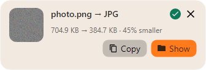

**When the card appears**

- When you save with a picture tool (Crop, Add background, Redact, Annotate)
- When a conversion from the ring takes longer than 5 seconds
- When a file failed or was skipped
- When a watch folder converts files

A conversion from the ring that finishes quickly only shows the ✓ in the ring.

**What you can do on the card**

- **Progress**: while it converts, a progress bar and a percentage show. **Cancel** stops it.
- **Preview**: when the result is a picture, a small preview shows. Click it to open the result.
- **Size change**: such as “704.9 KB → 384.7 KB · 45% smaller”.
- **Copy**: copies the result, so you can paste it into a chat or a document. The button says “Copied” for a moment.
- **Show**: opens the folder with the result.
- **×**: closes the card. Left alone, it goes away by itself after a while.

**When something fails**

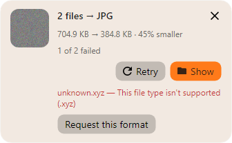

The card says how many failed, such as “1 of 2 failed”, and why for each file.

- **Retry**: converts only the files that failed again.
- **Request this format**: when Bingling doesn't know a format yet, you can ask for it.

You can find earlier results again under **Home → Recent conversions** in the Bingling window.

## Settings

Click the Bingling tray icon, or choose **Open Bingling** in its menu, to open the window. Pick a page on the left.

### Donut toolbar

Choose which slots each ring has, and in which order.

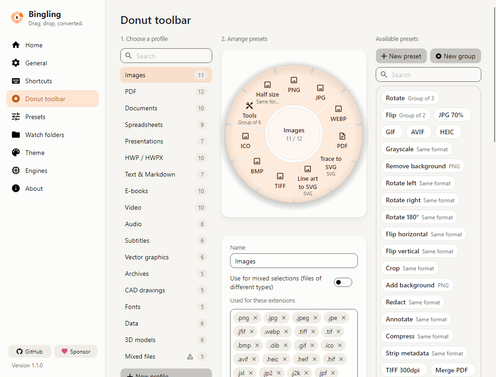

1. Under **1. Choose a profile**, pick the ring to change (Images, PDF, Documents…). The number is how many slots it has.
2. Arrange the slots under **2. Arrange presets**:
   - Drag a chip from **Available presets** onto the ring to add it.
   - Drag a slot back to the chips to remove it.
   - Drag slots onto each other to reorder them.
   - Right-click a slot or click ✎ to edit its preset.
3. A ring holds up to 12 slots.

- **New preset** makes a new slot and puts it on the ring you picked (when the ring has room).
- **New group** makes a group, one slot for several presets. Drag it onto the ring when it is ready.
- **Used for these extensions** decides which files open this ring.
- **Appearance** changes the size, the hole and the opacity of the ring.

### Presets

A preset is what one slot does, such as “PNG” or “JPG 70%”: what to convert to, and where to save it.

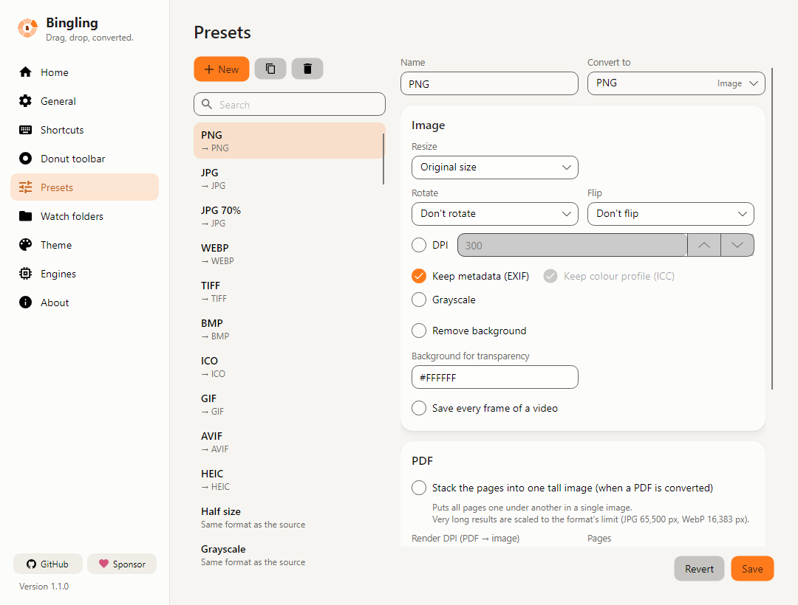

**Making your own**

1. On the **Presets** page, click **New**. Or select a similar preset and click **Duplicate**.
2. Set its **Name** and **Convert to**.
3. Set the options of that format: for pictures, the quality, resizing, rotation and so on.
4. Under **Output**, choose how to save:
   - **Save to**: the default save location, the same folder as the source, a subfolder, or a fixed folder
   - **File name**: built from words such as `{name}` (the original name) and `{date}`
   - **If the file exists**: Add a number, Replace it, or Skip
5. Click **Save**.
6. To put the preset on a ring, drag its chip onto the ring on the **Donut toolbar** page.

### Watch folders

Files that land in a folder you choose are converted on their own. Handy for scans and downloads.

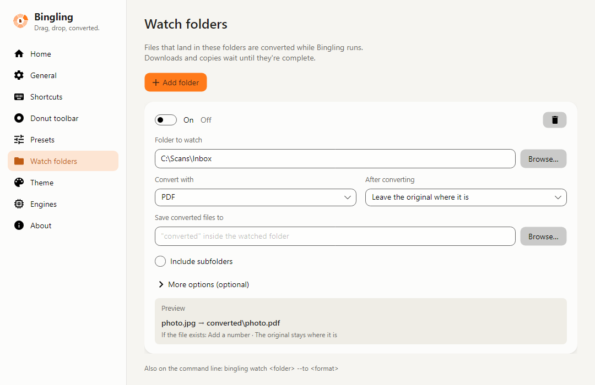

1. Click **Add folder**.
2. Choose the **Folder to watch** and the preset under **Convert with**.
3. Under **After converting**, choose “Leave the original where it is” or “Move the original to "originals"”.
4. Leave **Save converted files to** empty to save into a “converted” folder inside the watched folder.
5. Watching starts as soon as a folder is chosen. To pause it, switch off **On** at the top.

The **Preview** shows the name each file will get. **More options (optional)** chooses which files to convert and how to name them.
Watch folders work while Bingling runs. Files still downloading or copying are converted when they are complete.

### Theme

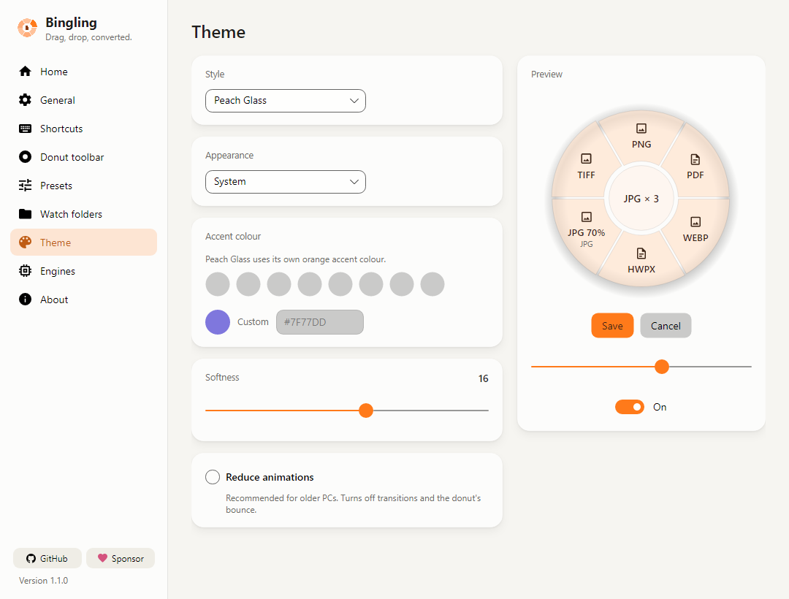

- **Style**: at first it is **Peach Glass**, a soft, see-through glass look. You can switch to the original program's classic style.
- **Appearance**: System, Light or Dark. System follows Windows.
- **Accent colour**: used by the classic style. Peach Glass uses its own orange accent colour.
- **Softness**: how round the corners are.
- **Reduce animations**: recommended for older PCs. Turns off transitions and the ring's bounce.

### Engines

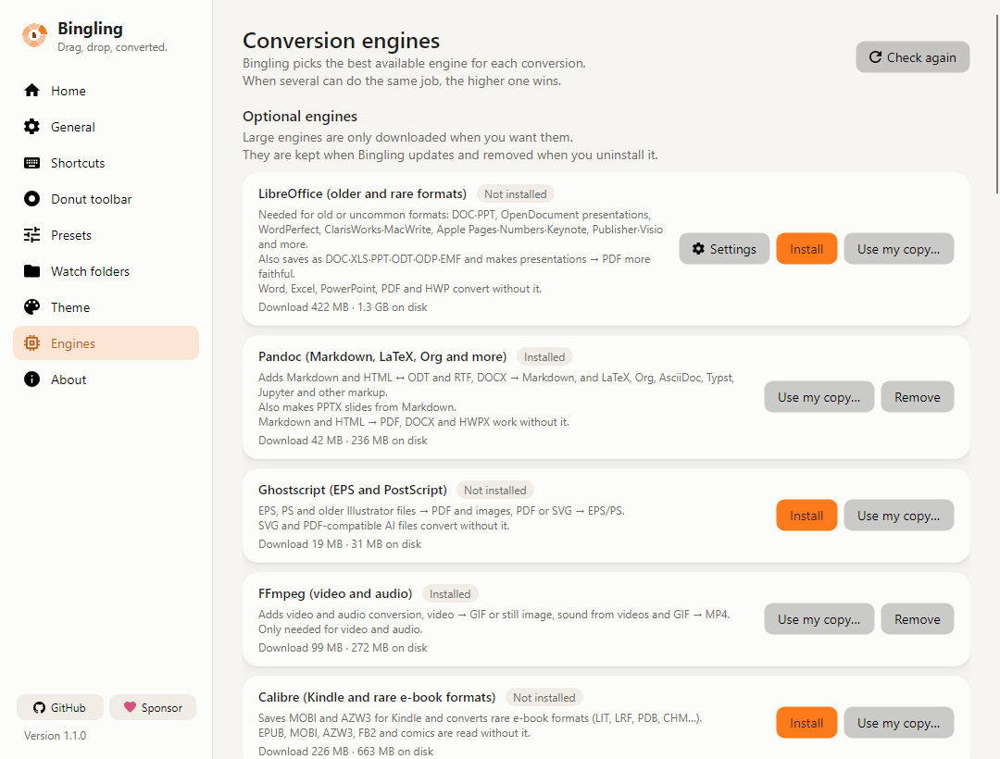

- Under **Optional engines**, **Install** or **Remove** LibreOffice, Pandoc, Ghostscript, FFmpeg and Calibre.
  A download shows a progress bar and the time left.
- If one is already installed on your PC, pick it with **Use my copy…** and Bingling uses it instead of downloading its own.
- Engines are kept when Bingling updates and removed when you uninstall it.
- Under **All engines** you can change the order. When several engines can do the same job, the higher one is used.

### Shortcuts

Choose how the ring opens. You can add as many gestures as you like.

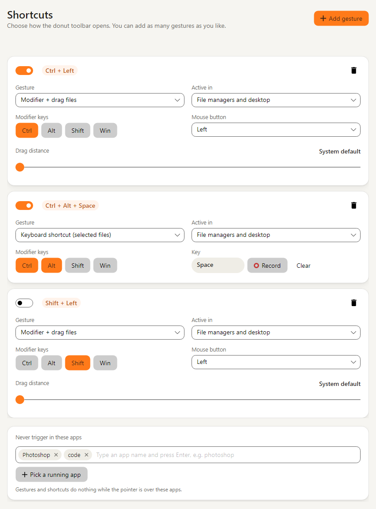

There are three at first:

| Gesture | At first |
|---|---|
| <kbd>Ctrl</kbd> + drag files | On |
| <kbd>Ctrl</kbd>+<kbd>Alt</kbd>+<kbd>Space</kbd> (files selected in File Explorer) | On |
| <kbd>Shift</kbd> + drag files | Off |

- The switch at the top left of each card turns it on or off. Change the keys under **Modifier keys** (Ctrl, Alt, Shift, Win).
- **Active in**: “File managers and desktop” opens the ring only in File Explorer and on the desktop. You can choose “Everywhere” instead.
- **Never trigger in these apps**: add a program in which you need Ctrl + drag for something else.
- To take a break, choose **Pause shortcuts** in the tray icon's menu.

### General

Language, starting when you sign in, what closing the window does, the Explorer context menu, and the **Default save location**.
The default save location is “Same folder as the source” at first.
Under **Image tools**, turn off “Close the editing window after Copy” to keep an editing window open after you copy.

## FAQ

**Does Bingling change my original files?**
No. Results are always saved as new files and the original stays as it is. Even a preset set to “Replace it” never replaces the original itself.
Only a watch folder set to “Move the original to "originals"” moves the original, into that folder.

**Are my files uploaded anywhere?**
No. Every conversion and edit happens on your PC. Bingling only goes online to download engines and to check for updates.

**Can it convert old .doc and .ppt files?**
Yes, with the **LibreOffice** engine. Without it the slot is dimmed, and pointing at it tells you to install it.
Install it in **Settings → Engines**. DOCX, XLSX, PPTX and HWP convert without LibreOffice.

**Setup asks for an administrator on my work PC.**
Choose **Install for me only** in Setup's first window. Bingling then installs for your account without administrator rights.
If Setup itself is blocked, unpack the [portable ZIP](#without-installing-portable) and use that.
If your company blocks unsigned programs from running at all, none of this helps. Ask your IT department.

**How do I update?**
When a new version is out, Bingling shows a card such as “Bingling 1.2.0 is available”. Click **Update** and it downloads and installs the new version.
Your settings and engines stay. You can also check yourself with **Check now** on the **About** page of the Bingling window.

**Can I use it together with the original Filee?**
Yes. Bingling keeps its own settings folder (`%APPDATA%\Bingling`) and its own Explorer menu entry, so neither touches the other's settings.
If both have the same shortcut switched on, though, it can get confusing. Change or switch off the shortcut in one of them.

**Where did my result go?**
With the first settings, most results go into the same folder as the original. **Home → Recent conversions** in the Bingling window has **Open folder** to take you there.

## Credits

Bingling is based on [Filee](https://github.com/KnifeLemon/Filee) 1.12.0 by KnifeLemon, released under the MIT license.
If you like the original, please support its author too: [GitHub Sponsors](https://github.com/sponsors/KnifeLemon)
