# 빙글링 사용 설명서

**한국어** · [English](en.md)

## 목차

1. [빙글링이란](#빙글링이란)
2. [설치](#설치)
3. [기본 사용법](#기본-사용법)
4. [링 읽는 법](#링-읽는-법)
5. [사진 도구 6가지](#사진-도구-6가지)
6. [편집 창 단축키](#편집-창-단축키)
7. [알림 카드](#알림-카드)
8. [설정](#설정)
9. [자주 묻는 질문](#자주-묻는-질문)
10. [원작](#원작)

## 빙글링이란

탐색기에서 파일을 끌다가 <kbd>Ctrl</kbd>을 누르면 커서 둘레에 둥근 링이 떠요.
원하는 칸에 놓기만 하면 형식을 바꾸거나 사진을 자르고, 가리고, 그릴 수 있어요. 탐색기를 떠날 필요가 없어요.

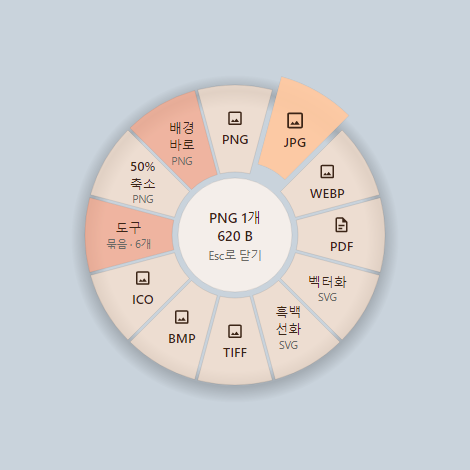

## 설치

Windows 10과 11에서 써요.

1. [릴리스 페이지](https://github.com/likyu-room/bingling/releases/latest)에서 `Bingling-<버전>-win-Setup.exe`를 받아 실행해요.
2. 설치 파일에 아직 코드 서명이 없어서 “Windows의 PC 보호” 창이 뜰 수 있어요.
   **추가 정보**를 누른 다음 **실행**을 누르면 설치가 이어져요.
3. **설치 모드**를 골라요.
   - **모든 사용자용으로 설치 (권장)**: 보통은 이걸 고르세요. 관리자 권한이 필요해서 확인 창이 한 번 떠요.
   - **현재 사용자용으로만 설치**: 관리자 권한 없이 내 계정에만 설치해요. 회사 PC처럼 관리자 계정과 비밀번호를 물어보는 창이 뜬다면 이걸 고르세요.
     이때는 Windows 11 기본 메뉴 옵션이 없어요. 빙글링은 “추가 옵션 표시” 안에 나와요.
4. 옵션을 골라요. 처음 설치할 때 나와요.

   | 옵션 | 처음 상태 | 하는 일 |
   |---|---|---|
   | 탐색기 우클릭 메뉴에 “빙글링으로 변환” 표시 | 켜짐 | 파일을 오른쪽 클릭해서 빙글링을 열 수 있어요. |
   | Windows 11 기본 메뉴에도 표시 | 켜짐 | Windows 11에서 모든 사용자용으로 설치할 때만 나와요. “추가 옵션 표시”를 누르지 않아도 메뉴에 보여요. |
   | 로그인할 때 빙글링 시작 | 켜짐 | 컴퓨터를 켜면 빙글링이 트레이에서 기다려요. 링은 빙글링이 실행 중일 때만 떠요. |
   | “bingling” 명령어를 PATH에 추가 | 꺼짐 | 명령 프롬프트에서 `bingling` 명령으로 변환해요. 필요한 분만 켜세요. |

5. **변환 엔진**을 골라요.
   사진, PDF, 워드·엑셀·파워포인트, HWP, 전자책, 압축 파일, 글꼴, CAD, 3D 모델은 엔진 없이 바로 변환돼요.
   아래 엔진은 용량이 커서 필요한 것만 받으면 돼요. 받는 크기는 고르는 화면에 나와요.

   | 엔진 | 이럴 때 필요해요 |
   |---|---|
   | LibreOffice | DOC·PPT 같은 옛 문서, Pages·Keynote·Numbers, 워드퍼펙트, Publisher·Visio |
   | Pandoc | 마크다운·LaTeX·Org 같은 문서 형식 바꾸기, 마크다운으로 PPTX 만들기 |
   | Ghostscript | EPS·PostScript, 예전 일러스트레이터 파일 |
   | FFmpeg | 동영상과 오디오 |
   | Calibre | 킨들용 MOBI·AZW3, 드문 전자책 형식 |

   고른 엔진은 설치가 끝나고 빙글링이 켜지면서 내려받아요.
   지금 고르지 않아도 괜찮아요. 엔진은 언제든 **설정 → 변환 엔진**에서 설치하거나 제거할 수 있어요.

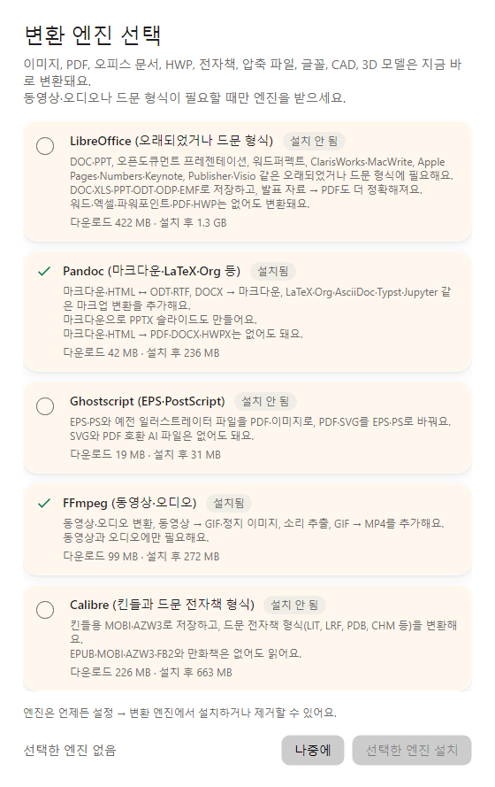

빙글링 안의 “변환 엔진 선택” 창이에요. 설치 프로그램에서도 같은 엔진을 골라요.

설치가 끝나면 빙글링은 작업 표시줄 알림 영역(트레이)에서 실행돼요.
업데이트할 때는 엔진을 다시 묻지 않아요. 설정과 엔진은 그대로 남아요.

### 설치 없이 쓰기(포터블)

설치 프로그램을 실행할 수 없거나 설치하고 싶지 않다면 포터블 ZIP을 써요. 관리자 권한이 필요 없어요.

1. [릴리스 페이지](https://github.com/likyu-room/bingling/releases/latest)에서 `Bingling-<버전>-win-Portable.zip`을 받아요.
2. 계속 둘 폴더에 압축을 풀어요(예: `문서\빙글링`).
3. 폴더 안의 `Bingling.exe`를 실행해요. “Windows의 PC 보호” 창이 뜨면 **추가 정보** → **실행**을 눌러요.

- 링, 사진 도구, 변환, 알림 카드, 엔진 받기는 설치판과 똑같아요.
- 처음 켜면 “로그인할 때 빙글링 시작”과 탐색기 우클릭 메뉴가 내 계정에 등록돼요. 우클릭 메뉴는 Windows 11에서 “추가 옵션 표시” 안에 나와요.
- 설정은 설치판과 같은 곳(`%APPDATA%\Bingling`)에 저장돼요. USB에 넣어 다른 PC로 들고 다니는 용도는 아니에요.

**업데이트**: 새 버전이 나오면 카드에 **다운로드** 단추가 떠요. 누르면 릴리스 페이지가 열려요.
트레이 아이콘을 오른쪽 클릭해서 **종료**한 다음, 새 ZIP을 같은 폴더에 덮어 풀면 돼요. 설정과 엔진은 그대로예요.

**그만 쓸 때**: **설정 → 일반**에서 “로그인할 때 빙글링 시작”과 “탐색기 우클릭 메뉴에 ‘빙글링으로 변환’ 표시”를 끄고,
트레이에서 **종료**한 뒤 폴더를 지워요.
받은 엔진까지 지우려면 `%LocalAppData%\Bingling` 폴더도 지워요.

## 기본 사용법

### 끌어서 링 열기

1. 탐색기나 바탕 화면에서 파일을 끌어요. 여러 개를 한꺼번에 끌어도 돼요.
2. 끄는 중에 <kbd>Ctrl</kbd>을 눌러요. 커서 둘레에 링이 떠요. (<kbd>Ctrl</kbd>을 먼저 누르고 끌어도 돼요.)
3. 원하는 칸 위에서 마우스 단추를 놓아요.

놓으면 링이 작은 진행 링으로 바뀌고, 끝나면 ✓ 표시가 떠요.
5초보다 오래 걸리면 화면 오른쪽 아래 [알림 카드](#알림-카드)로 넘어가서 계속 보여 줘요.
결과가 사진이면 금방 끝나도 알림 카드에 결과 미리보기가 떠요.

결과는 **원본과 같은 폴더에 새 파일로** 저장돼요. 원본은 그대로예요.
같은 이름의 파일이 이미 있으면 이름 뒤에 번호를 붙여요(예: `사진 (2).jpg`).

그만두고 싶으면 링 가운데에 놓으세요. 가운데에 “여기에 놓으면 취소”가 떠요.

### 그 밖에 여는 방법

| 방법 | 이렇게 해요 |
|---|---|
| 키보드 단축키 | 탐색기에서 파일을 고른 다음 <kbd>Ctrl</kbd>+<kbd>Alt</kbd>+<kbd>Space</kbd>를 눌러요. 마우스 커서가 탐색기 창 위에 있으면 그 자리에 링이 떠요. |
| 오른쪽 클릭 메뉴 | 파일을 오른쪽 클릭하고 **빙글링으로 변환**을 골라요. Windows 11에서 기본 메뉴에 넣지 않았다면 “추가 옵션 표시” 안에 있어요. |
| 빙글링 창 | 빙글링 창의 **홈**에 있는 “여기에 파일을 놓으세요” 칸에 파일을 끌어다 놓아요. |
| 자동 변환 폴더 | 정해 둔 폴더에 파일이 들어오면 알아서 변환해요. [설정](#자동-변환-폴더)에서 만들어요. |

이렇게 연 링은 칸을 **클릭**해서 골라요. 가운데에 “Esc로 닫기”가 보이고, <kbd>Esc</kbd>를 누르면 닫혀요.
화살표 키나 <kbd>Tab</kbd>으로 칸을 옮기고 <kbd>Enter</kbd>로 골라도 돼요.

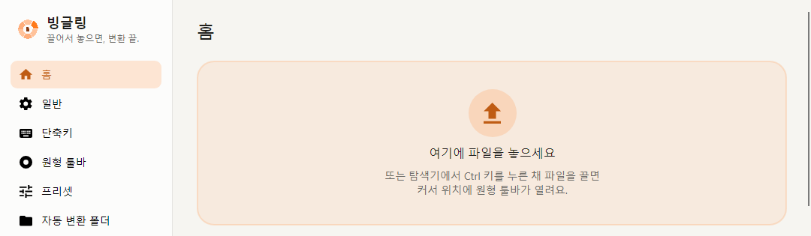

**Shift로도 열고 싶다면:** **설정 → 단축키**에 “Shift + Left” 제스처가 꺼진 채 들어 있어요. 스위치를 켜면 <kbd>Shift</kbd>를 누르고 끌어도 링이 떠요.

**빙글링 창을 닫을 때:** “빙글링을 계속 실행할까요?”라고 물으면 **트레이에 유지**를 고르세요.
**종료**를 고르면 빙글링이 꺼져서 링이 뜨지 않아요. 다시 열 때는 트레이 아이콘을 누르면 돼요.

## 링 읽는 법

위의 [링 그림](#빙글링이란)을 보면서 읽어 보세요.

- **가운데**: 가져온 파일의 형식과 개수, 전체 크기가 보여요(예: “PNG 1개 · 620 B”, 형식이 섞이면 “파일 3개”).
  칸 위에 올리면 아랫줄이 “놓기 → JPG”처럼 바뀌어서 무엇을 할지 알려 줘요. 클릭으로 고르는 링에서는 “클릭 → JPG”로 보여요.
  가운데에 올리면 “여기에 놓으면 취소”가 떠요.
- **칸**: 칸마다 하는 일이 하나씩 있어요. 큰 글씨는 이름, 작은 글씨는 결과 형식이에요.
  “50% 축소”처럼 형식을 바꾸지 않는 칸은 작은 글씨에 원본 형식이 보여요.
- **파일에 맞는 링**: 사진, PDF, 문서, 동영상처럼 파일 종류마다 다른 링이 떠요. 종류가 섞이면 “혼합 파일” 링이 떠요.
  링마다 칸은 12개까지 넣을 수 있어요.
- **묶음 칸**: “도구” 칸처럼 작은 글씨로 “묶음 · 6개”가 적힌 칸에는 여러 칸이 들어 있어요.
  그 칸에 잠깐 머물거나 바깥쪽으로 움직이면 둘레에 작은 칸이 펼쳐져요. 끄는 중이라면 펼쳐진 칸에 놓으면 돼요.
- **흐린 칸**: 지금 파일로는 할 수 없는 칸이에요. 올려 보면 가운데에 이유가 나와요. 예를 들면 이래요.
  - “FFmpeg (동영상·오디오) 필요 (설정 → 변환 엔진에서 설치)”: 그 엔진을 설치하면 쓸 수 있어요.
  - “한 장짜리 사진만 편집할 수 있어요”: 움직이는 GIF처럼 여러 장짜리 그림에는 사진 도구를 못 써요.
  - “이 변환을 할 수 있는 엔진이 없어요”
- **칸 고치기**: 단축키나 메뉴로 연 링에서는 칸을 오른쪽 클릭하면 그 칸의 설정(프리셋)을 바로 고칠 수 있어요.

## 사진 도구 6가지

사진 링의 **도구** 칸에 여섯 가지 도구가 모여 있어요. 도구 칸에 머물면 둘레에 펼쳐져요.

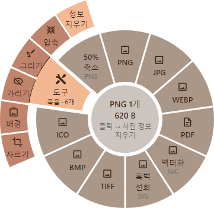

- **자르기, 배경 넣기, 가리기, 그리기**는 편집 창이 열려요. 창은 링이 있던 자리에 떠요.
- **압축, 사진 정보 지우기**는 창 없이 바로 처리해요.
- 자르기, 배경 넣기, 가리기, 그리기는 한 장짜리 사진에만 써요. 움직이는 GIF나 아이콘(ICO)이 섞여 있으면 이 칸들이 흐리게 보여요.

### 편집 창에서 같이 쓰는 것

- 위쪽 왼편에 도구 이름과 파일 이름이 보여요(예: “자르기 · beach.png”).
- 위쪽 오른편 단추는 **되돌리기**, **다시 하기**, **화면에 맞춤**이에요.
- 맨 아래 단추는 **초기화**, **취소**, **복사**, **저장**이에요. 왼쪽에 “원본은 그대로 두고 옆에 새 파일로 저장해요”라고 나오듯, 원본은 바뀌지 않아요.
- **복사**(<kbd>Ctrl</kbd>+<kbd>C</kbd>)는 파일을 만들지 않고 고친 사진을 바로 복사해요. 대화창이나 문서에 붙여 넣으면 돼요.
  복사하면 창이 닫혀요. 창을 열어 두고 더 고치거나 저장도 하고 싶으면 **설정 → 일반 → 사진 도구**에서 바꿔요.
  여러 장을 가져왔다면 지금 보고 있는 사진만 복사하고, 다음 사진도 복사할 수 있게 창은 열려 있어요.

**여러 파일을 한 번에 다루기**

여러 장을 함께 가져오면 위쪽에 “2개 중 1”처럼 몇 번째 사진인지 나와요.
‹ › 단추나 <kbd>←</kbd> <kbd>→</kbd> 키로 사진을 넘겨 볼 수 있어요.

- 자르기, 배경 넣기, 가리기: 고른 설정이 **모든 사진에 똑같이** 들어가요. 아래에 “파일 2개에 똑같이 적용돼요”라고 나와요.
- 그리기: **사진마다 따로** 그려요. 그림을 그린 사진만 저장해요.

**저장되는 이름**

이름 뒤에 영어 낱말이 붙어요. `사진.jpg`를 예로 들면 이래요.

| 도구 | 저장되는 파일 |
|---|---|
| 자르기 | `사진 Cropped.jpg` |
| 배경 넣기 | `사진 with background.png` (늘 PNG로 저장해요) |
| 가리기 | `사진 Redacted.jpg` |
| 그리기 | `사진 Annotated.jpg` |
| 압축 | `사진 Compressed.jpg` |
| 사진 정보 지우기 | `사진 Clean.jpg` |

배경 넣기 말고는 원본과 같은 형식으로 저장해요.

### 자르기

사진에서 원하는 부분만 남겨요.

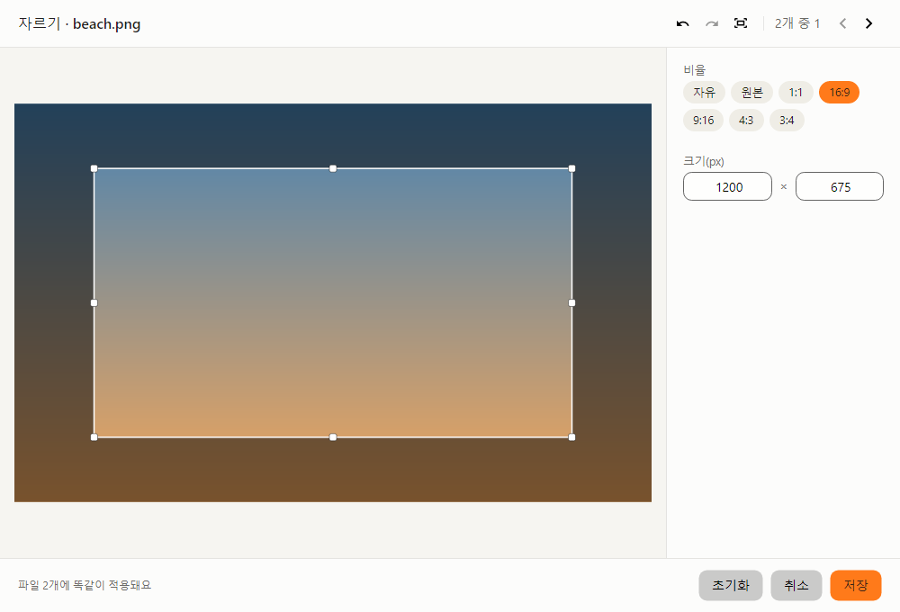

1. 사진을 끌어 와서 **도구 → 자르기**에 놓아요.
2. 오른쪽 **비율**에서 모양을 골라요. 자유, 원본, 1:1, 16:9, 9:16, 4:3, 3:4가 있어요. 숫자 키 <kbd>1</kbd>~<kbd>7</kbd>로도 골라요.
3. 상자를 끌어 자리를 옮기고, 모서리나 테두리를 끌어 크기를 바꿔요. 상자 밖을 끌면 상자를 새로 그려요.
   **크기(px)** 칸에 숫자를 넣어도 돼요.
4. **저장**을 누르거나 <kbd>Enter</kbd>를 눌러요. 상자 안을 두 번 클릭해도 저장돼요.

- “자유”일 때 <kbd>Shift</kbd>를 누른 채 끌면 상자 모양이 그대로 유지돼요.
- 고른 비율은 다음에 열 때도 기억해요.

### 배경 넣기

사진 둘레에 여백과 배경을 넣어 카드처럼 꾸며요. 모서리를 둥글게 하고 그림자도 넣을 수 있어요.

1. 사진을 **도구 → 배경 넣기**에 놓아요.
2. **배경**에서 그라데이션 8가지나 단색 6가지 중에 골라요.
   - **사용자 색**: `#FF7A1A` 같은 색 코드를 넣으면 바로 바뀌어요.
   - **그림 고르기…**: 내 그림을 배경으로 써요.
   - **사진 색**: 사진의 평균색을 흰색과 섞은 옅은 색으로 배경을 채워요.
3. **여백**, **모서리**, **그림자** 막대를 움직여요. 막대 오른쪽 위에 값이 보여요.
4. **비율**에서 결과 모양을 골라요. 자동, 1:1, 16:9, 9:16, 4:5, 4:3이 있어요. 결과 크기는 “결과 1112 × 812px”처럼 보여요.
5. **저장**을 눌러요.

결과는 늘 PNG로 저장해요. 고른 배경은 다음에도 기억해요.

### 가리기

이름이나 전화번호처럼 보여 주기 싫은 곳을 검은 상자나 모자이크로 가려요.

1. 사진을 **도구 → 가리기**에 놓아요.
2. **방식**에서 **검은 상자**(<kbd>B</kbd>)나 **모자이크**(<kbd>M</kbd>)를 골라요.
3. 사진 위를 끌어서 가릴 곳에 상자를 그려요. 몇 개든 그릴 수 있어요.
   - 상자를 누르면 골라지고, 끌면 옮겨지고, 모서리를 끌면 크기가 바뀌어요.
   - 고른 상자는 **고른 것 지우기**나 <kbd>Delete</kbd>로 지워요.
4. **저장**을 눌러요. 상자가 하나도 없으면 저장 단추가 꺼져 있어요.

> **사진 정보도 함께 지워요.** 가리기 결과에서는 찍은 장소나 카메라 같은 사진 정보(EXIF)를 늘 지워요.
> 사진 정보 안에 가린 내용이 남아 있을 수 있어서예요.

여러 장을 가져오면 모든 사진의 같은 자리에 같은 상자가 들어가요. ‹ ›로 사진마다 확인해 보세요.

### 그리기

화살표, 글자, 번호 등으로 사진에 표시를 해요.

1. 사진을 **도구 → 그리기**에 놓아요.
2. 오른쪽 위에서 도구를 골라요.

   | 도구 | 키 | 쓰는 법 |
   |---|---|---|
   | 선택 | <kbd>V</kbd> | 눌러서 고르고 끌어서 옮겨요. 글자는 두 번 눌러 고쳐요. |
   | 펜 | <kbd>P</kbd> | 끌어서 그려요. |
   | 형광펜 | <kbd>H</kbd> | 끌어서 그려요. 뒤가 비치는 굵은 선이에요. |
   | 화살표 | <kbd>A</kbd> | 끌어서 그려요. <kbd>Shift</kbd>를 누르면 반듯하게 꺾여요. |
   | 선 | <kbd>L</kbd> | 끌어서 그려요. <kbd>Shift</kbd>를 누르면 반듯하게 꺾여요. |
   | 사각형 | <kbd>R</kbd> | 끌어서 그려요. <kbd>Shift</kbd>를 누르면 정사각형이 돼요. |
   | 원 | <kbd>E</kbd> | 끌어서 그려요. <kbd>Shift</kbd>를 누르면 정원이 돼요. |
   | 글자 | <kbd>T</kbd> | 누른 곳에 써요. <kbd>Enter</kbd>로 마치고, <kbd>Shift</kbd>+<kbd>Enter</kbd>로 줄을 바꿔요. |
   | 번호 | <kbd>N</kbd> | 누를 때마다 1, 2, 3… 번호가 붙어요. |

3. **색**(8가지, 또는 **사용자 색**에 색 코드)과 **굵기**(가늘게, 보통, 굵게)를 골라요.
   굵기는 <kbd>[</kbd> <kbd>]</kbd> 키로도 바꾸고, 글자와 번호의 크기도 같이 바뀌어요.
4. **저장**을 눌러요. 아무것도 그리지 않으면 저장 단추가 꺼져 있어요.

- 그려 놓은 것을 선택 도구로 고른 다음 색이나 굵기를 누르면 그 그림이 바로 바뀌어요. 지우려면 <kbd>Delete</kbd>를 눌러요.
- **사진마다 따로 그려요.** 다른 사진으로 넘어가면 그 사진에 그린 것만 보여요. 되돌리기도 사진마다 따로예요.
  그린 사진만 저장하고, 아래에 “그린 파일 2개만 저장돼요”처럼 알려 줘요.
- 그린 게 있는데 닫으려고 하면 “그린 내용을 버리고 닫을까요?”라고 물어요. **버리기**나 **계속 그리기**를 골라요.

### 압축

사진 파일의 크기를 줄여요. 칸에 놓으면 창 없이 바로 처리해요.

- 사진 정보(EXIF)도 함께 지워요.
- 결과가 원본보다 작지 않으면 새 파일을 남기지 않아요. 알림 카드에 “건너뜀 (더 작아지지 않음)”이 떠요.

### 사진 정보 지우기

찍은 장소, 카메라, 날짜 같은 사진 정보(EXIF)를 지운 새 파일을 만들어요. 링에는 “정보 지우기”로 보여요.
칸에 놓으면 창 없이 바로 처리해요. 색이 달라지지 않도록 색 프로필은 남겨요.

## 편집 창 단축키

자르기, 배경 넣기, 가리기, 그리기 창에서 써요. 단추에 마우스를 올리면 단축키가 보여요.

| 키 | 하는 일 |
|---|---|
| <kbd>Enter</kbd> | 저장. 크기 칸에 숫자를 넣는 중이면 숫자를 먼저 적용해요. |
| <kbd>Esc</kbd> | 취소하고 닫기 |
| <kbd>Ctrl</kbd>+<kbd>C</kbd> | 파일을 만들지 않고 복사. 크기 칸에 숫자를 넣는 중이면 그 글자를 복사해요. |
| <kbd>Ctrl</kbd>+<kbd>Z</kbd> | 되돌리기 |
| <kbd>Ctrl</kbd>+<kbd>Y</kbd> (또는 <kbd>Ctrl</kbd>+<kbd>Shift</kbd>+<kbd>Z</kbd>) | 다시 하기 |
| <kbd>Ctrl</kbd>+<kbd>0</kbd> | 화면에 맞춤 |
| <kbd>Ctrl</kbd>+<kbd>1</kbd> | 실제 크기(100%)로 보기 |
| 마우스 휠 | 마우스가 있는 곳을 중심으로 확대·축소 |
| <kbd>Space</kbd>+끌기 (또는 가운데 단추로 끌기) | 확대한 사진 옮기기 |
| <kbd>←</kbd> <kbd>→</kbd> | 이전 사진, 다음 사진 |

도구마다 쓰는 키예요.

| 도구 | 키 |
|---|---|
| 자르기 | <kbd>1</kbd>~<kbd>7</kbd> 비율 고르기 (자유, 원본, 1:1, 16:9, 9:16, 4:3, 3:4) · <kbd>Shift</kbd>+끌기 모양 유지 |
| 가리기 | <kbd>B</kbd> 검은 상자 · <kbd>M</kbd> 모자이크 · <kbd>Delete</kbd> 고른 상자 지우기 |
| 그리기 | <kbd>V</kbd> <kbd>P</kbd> <kbd>H</kbd> <kbd>A</kbd> <kbd>L</kbd> <kbd>R</kbd> <kbd>E</kbd> <kbd>T</kbd> <kbd>N</kbd> 도구 고르기 · <kbd>[</kbd> <kbd>]</kbd> 굵기 · <kbd>Delete</kbd> 고른 것 지우기 |

배경 넣기에는 따로 쓰는 키가 없어요.

## 알림 카드

변환이 끝나면 화면 오른쪽 아래에 카드가 떠요.

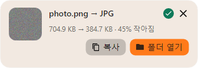

**카드가 뜨는 때**

- 사진 도구(자르기, 배경 넣기, 가리기, 그리기)로 저장했을 때
- 링으로 바꾼 결과가 사진일 때 (금방 끝나도 떠서 결과를 바로 보고 복사할 수 있어요)
- 링으로 시작한 변환이 5초보다 오래 걸릴 때
- 실패하거나 건너뛴 파일이 있을 때
- 자동 변환 폴더가 파일을 변환했을 때

PDF처럼 사진이 아닌 결과가 링에서 금방 끝나면 링 안의 ✓로만 알려 줘요.

**카드에서 할 수 있는 것**

- **진행**: 변환하는 동안 진행 막대와 %가 보여요. **취소**로 멈출 수 있어요.
- **결과 미리보기**: 결과가 사진이면 작은 그림이 보여요. 그림을 누르면 결과 파일이 열려요.
- **크기 변화**: “704.9 KB → 384.7 KB · 45% 작아짐”처럼 크기가 어떻게 바뀌었는지 알려 줘요.
- **복사**: 결과를 복사해요. 대화창이나 문서에 바로 붙여 넣을 수 있어요. 누르면 잠깐 “복사됨”으로 바뀌어요.
- **폴더 열기**: 결과가 있는 폴더를 열어요.
- **×**: 카드를 닫아요. 그냥 두어도 잠시 뒤 저절로 사라져요.

**실패했을 때**

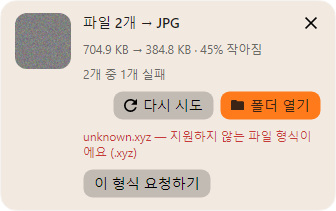

“2개 중 1개 실패”처럼 몇 개가 실패했는지와 파일마다 이유가 보여요.

- **다시 시도**: 실패한 파일만 다시 변환해요.
- **이 형식 요청하기**: 빙글링이 아직 모르는 형식이면 지원해 달라고 알릴 수 있어요.

지난 결과는 빙글링 창의 **홈 → 최근 변환**에서 다시 찾을 수 있어요.

## 설정

트레이의 빙글링 아이콘을 누르거나 메뉴에서 **빙글링 열기**를 고르면 창이 열려요. 왼쪽 목록에서 설정 화면을 골라요.

### 원형 툴바

링에 어떤 칸을 어떤 순서로 넣을지 정해요.

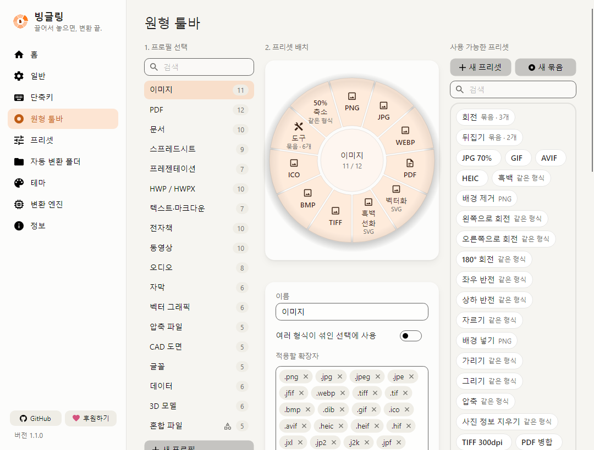

1. **1. 프로필 선택**에서 고칠 링을 골라요(이미지, PDF, 문서…). 오른쪽 숫자는 칸 개수예요.
2. **2. 프리셋 배치**에서 칸을 정리해요.
   - 오른쪽 **사용 가능한 프리셋**의 칩을 링으로 끌면 칸이 늘어요.
   - 칸을 칩 목록 쪽으로 끌어 놓으면 빠져요.
   - 칸끼리 끌어 놓으면 순서가 바뀌어요.
   - 칸을 오른쪽 클릭하거나 ✎을 누르면 그 프리셋을 고쳐요.
3. 링 하나에는 칸을 12개까지 넣을 수 있어요.

- **새 프리셋**: 새 칸을 만들어 지금 고른 링에 바로 넣어요(링에 자리가 있을 때).
- **새 묶음**: 여러 칸을 한 칸에 담는 묶음을 만들어요. 만든 뒤 링으로 끌어 넣어요.
- 아래쪽 **적용할 확장자**에서 이 링이 어떤 파일에 뜰지 정해요.
- **모양**에서 링의 크기, 구멍, 불투명도를 바꿔요.

### 프리셋

프리셋은 칸 하나가 하는 일이에요. “PNG로 바꾸기”, “JPG 70%”처럼 무엇으로 바꾸고 어디에 저장할지 정해요.

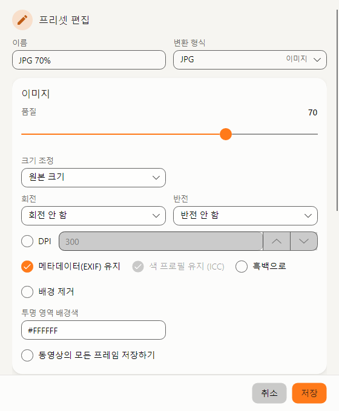

프리셋 편집 창이에요. 프리셋 화면의 오른쪽에도 같은 항목이 나와요.

**직접 만들기**

1. **프리셋** 화면에서 **새로 만들기**를 눌러요. 비슷한 프리셋이 있으면 골라서 **복제**해도 돼요.
2. **이름**과 **변환 형식**을 정해요.
3. 형식에 맞는 옵션을 정해요. 사진이면 품질, 크기 조정, 회전 같은 것들이에요.
4. **출력**에서 저장 방법을 정해요.
   - **저장 위치**: 기본 저장 위치, 원본과 같은 폴더, 하위 폴더, 지정한 폴더
   - **파일 이름**: `{name}`(원래 이름), `{date}`(날짜) 같은 낱말을 넣어 정해요.
   - **같은 파일이 있으면**: 번호 붙이기, 덮어쓰기, 건너뛰기
5. **저장**을 눌러요.
6. 만든 프리셋을 링에 넣으려면 **원형 툴바** 화면에서 칩을 링으로 끌어 놓아요.

### 자동 변환 폴더

정해 둔 폴더에 파일이 들어오면 빙글링이 알아서 변환해요. 스캔한 파일이나 내려받은 파일을 정리할 때 편해요.

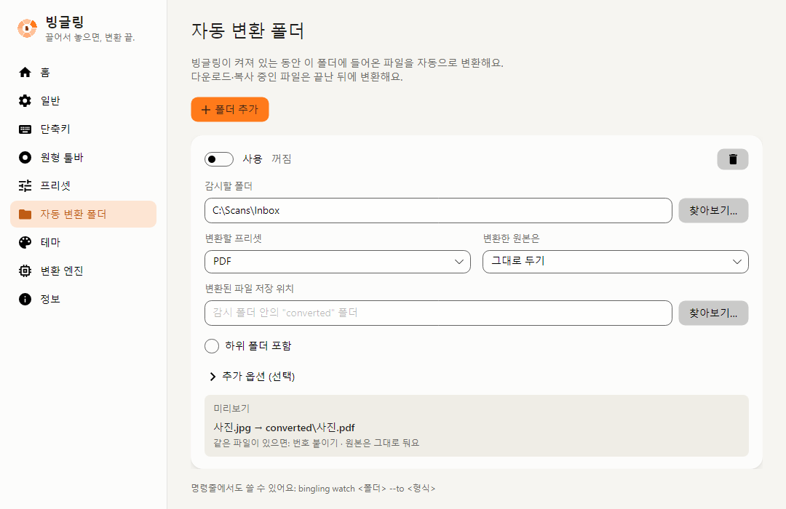

1. **폴더 추가**를 눌러요.
2. **감시할 폴더**와 **변환할 프리셋**을 골라요.
3. **변환한 원본은**에서 “그대로 두기”나 “"originals" 폴더로 옮기기”를 골라요.
4. **변환된 파일 저장 위치**를 비워 두면 감시 폴더 안의 “converted” 폴더에 저장해요.
5. 폴더를 고르면 바로 감시를 시작해요. 잠깐 멈추려면 맨 위 **사용** 스위치를 꺼요.

아래 **미리보기**에 파일이 어떤 이름으로 저장될지 나와요. **추가 옵션 (선택)**에서 변환할 파일 종류와 이름 규칙을 정할 수 있어요.
빙글링이 켜져 있는 동안만 동작하고, 내려받거나 복사하는 중인 파일은 끝난 뒤에 변환해요.

### 테마

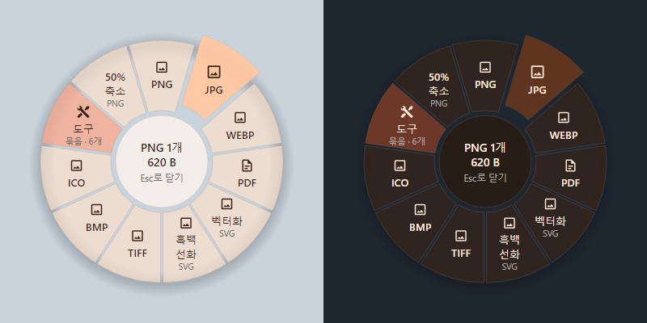

피치 글래스 테마의 링이에요. 왼쪽이 라이트, 오른쪽이 다크예요.

- **스타일**: 처음에는 은은하게 비치는 유리 느낌의 **피치 글래스**예요. 원작의 기본 스타일로 바꿀 수도 있어요.
- **모드**: 시스템, 라이트, 다크 중에 골라요. 시스템은 Windows 설정을 따라가요.
- **강조색**: 원작 스타일에서 쓰는 색이에요. 피치 글래스는 자기만의 주황색 강조색을 써요.
- **말랑함**: 모서리가 얼마나 둥근지 정해요.
- **애니메이션 줄이기**: 저사양 PC에 권장해요. 전환 효과와 링의 튕김 효과를 꺼요.

### 변환 엔진

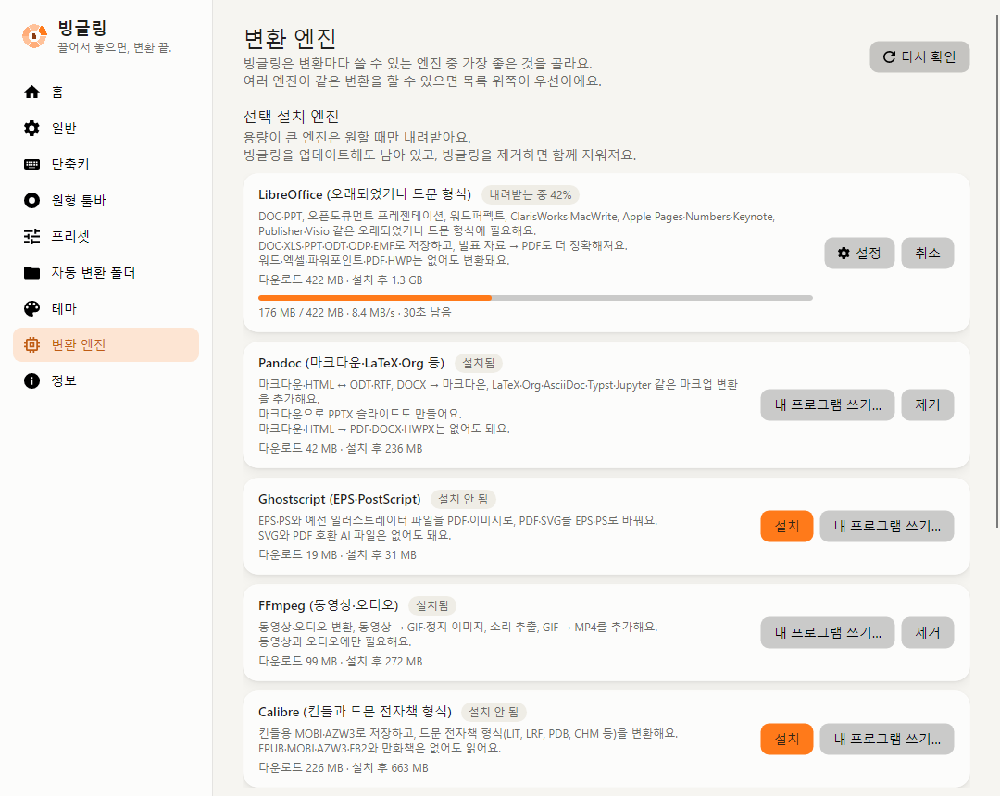

- **선택 설치 엔진**에서 LibreOffice, Pandoc, Ghostscript, FFmpeg, Calibre를 **설치**하거나 **제거**해요.
  내려받는 동안 진행 막대와 남은 시간이 보여요.
- 이미 컴퓨터에 설치해 둔 프로그램이 있으면 **내 프로그램 쓰기…**로 골라요. 따로 내려받지 않아요.
- 엔진은 빙글링을 업데이트해도 남아 있고, 빙글링을 제거하면 함께 지워져요.
- 아래 **전체 엔진**에서는 엔진 순서를 바꿀 수 있어요. 같은 변환을 여러 엔진이 할 수 있으면 위에 있는 엔진을 먼저 써요.

### 단축키

링을 여는 방법을 정해요. 제스처는 원하는 만큼 추가할 수 있어요.

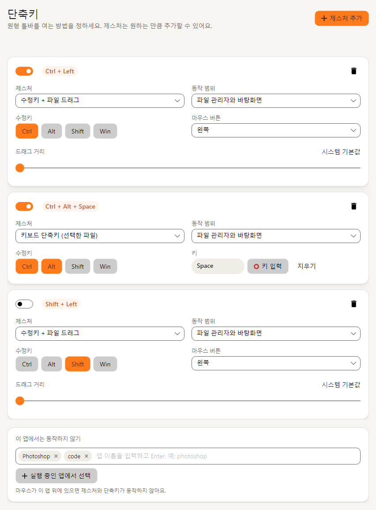

처음에는 세 가지가 들어 있어요.

| 제스처 | 처음 상태 |
|---|---|
| <kbd>Ctrl</kbd> + 파일 끌기 | 켜짐 |
| <kbd>Ctrl</kbd>+<kbd>Alt</kbd>+<kbd>Space</kbd> (탐색기에서 고른 파일) | 켜짐 |
| <kbd>Shift</kbd> + 파일 끌기 | 꺼짐 |

- 카드 왼쪽 위 스위치로 켜고 꺼요. **수정키**에서 Ctrl, Alt, Shift, Win을 골라 바꿀 수 있어요.
- **동작 범위**: “파일 관리자와 바탕화면”이면 탐색기와 바탕 화면에서만 떠요. “모든 곳”으로 바꿀 수도 있어요.
- **이 앱에서는 동작하지 않기**: 다른 프로그램에서 Ctrl+끌기를 써야 할 때 그 프로그램 이름을 넣어 두세요.
- 잠깐 쉬고 싶으면 트레이 아이콘 메뉴에서 **단축키 일시 중지**를 골라요.

### 일반

언어, 로그인할 때 시작, 창을 닫을 때, 탐색기 우클릭 메뉴, **기본 저장 위치**를 정해요.
기본 저장 위치는 처음에 “원본과 같은 폴더”예요.
**사진 도구**의 “편집 창에서 복사하면 창 닫기”를 끄면, 편집 창에서 복사한 뒤에도 창이 열려 있어요.

## 자주 묻는 질문

**원본 파일이 바뀌나요?**
아니요. 결과는 늘 새 파일로 저장하고 원본은 그대로 둬요. 프리셋에서 “덮어쓰기”를 골라도 원본 자체는 덮어쓰지 않아요.
자동 변환 폴더에서 “"originals" 폴더로 옮기기”를 고른 경우에만 원본이 그 폴더로 옮겨져요.

**파일이 인터넷으로 올라가나요?**
아니요. 변환과 편집은 모두 내 PC에서 해요. 인터넷은 변환 엔진을 내려받거나 업데이트를 확인할 때만 써요.

**옛 .doc, .ppt 파일도 바꿀 수 있나요?**
네. **LibreOffice** 엔진이 있으면 돼요. 없으면 칸이 흐리게 보이고, 올려 보면 설치하라고 알려 줘요.
**설정 → 변환 엔진**에서 설치하세요. .docx, .xlsx, .pptx와 HWP는 LibreOffice 없이도 변환돼요.

**회사 PC에서 설치하려니 관리자 계정을 물어봐요.**
설치 프로그램의 첫 창에서 **현재 사용자용으로만 설치**를 고르세요. 관리자 권한 없이 내 계정에만 설치돼요.
설치 프로그램 자체가 막혀 있다면 [포터블 ZIP](#설치-없이-쓰기포터블)을 풀어서 써 보세요.
회사가 서명 없는 프로그램의 실행 자체를 막아 두었다면 이 방법들로도 실행되지 않아요. 이때는 회사 IT 담당자에게 문의하세요.

**업데이트는 어떻게 하나요?**
새 버전이 나오면 빙글링이 “빙글링 1.2.0 버전이 나왔어요” 같은 카드로 알려 줘요. **업데이트**를 누르면 새 버전을 받아서 설치해요.
설정과 엔진은 그대로 남아요. 빙글링 창의 **정보** 화면에서 **지금 확인**을 눌러 직접 확인할 수도 있어요.

**원본 Filee와 같이 써도 되나요?**
네. 빙글링은 설정 폴더(`%APPDATA%\Bingling`)와 탐색기 메뉴를 원본과 따로 써서 서로의 설정을 건드리지 않아요.
다만 두 프로그램에 같은 단축키가 켜져 있으면 헷갈릴 수 있어요. 한쪽의 단축키를 바꾸거나 꺼 두세요.

**결과 파일이 어디 있는지 모르겠어요.**
처음 설정에서는 대부분 원본과 같은 폴더에 저장해요. 빙글링 창의 **홈 → 최근 변환**에서 **폴더 열기**를 누르면 바로 찾아가요.

## 원작

빙글링은 KnifeLemon이 만든 [Filee](https://github.com/KnifeLemon/Filee) 1.12.0을 바탕으로 만들었어요. Filee는 MIT 라이선스로 공개된 프로그램이에요.
원작이 마음에 든다면 원작자도 응원해 주세요: [GitHub Sponsors](https://github.com/sponsors/KnifeLemon)
